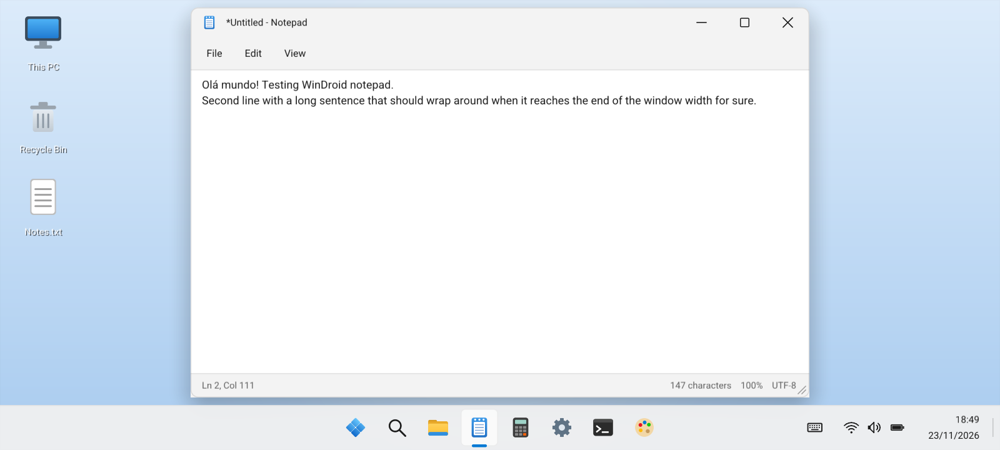
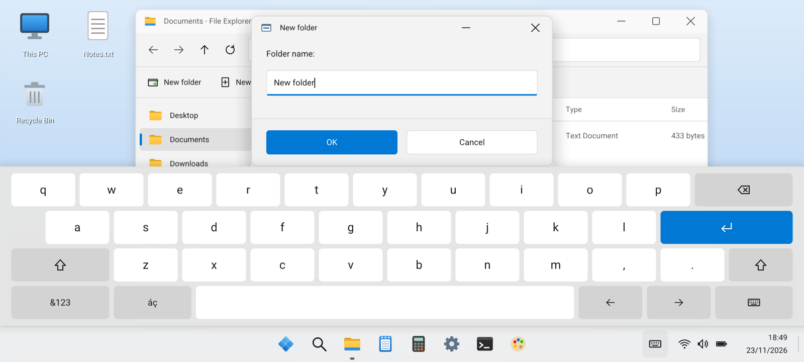

# windows-on-android

**WinDroid** is a Windows 11 style desktop for Android, written from scratch in C++ (NDK + OpenGL ES 2.0). It does not emulate or run real Windows: the shell, the window manager and every app are native code drawn on the GPU.


## Features

- Boot screen, lock screen (swipe up or tap), sleep, restart and shut down
- Centered taskbar (or left aligned) with running indicators, clock, tray and show desktop
- Start menu with pinned apps, all apps, recommended files and search
- Real window manager: drag, resize, minimize, maximize, double tap to maximize, snap to the top or sides, open and close animations
- Quick settings (dark mode, night light, brightness, real battery level) and a calendar flyout
- Built-in touch keyboard with symbols and accented characters, plus hardware keyboard support
- Desktop icons and a context menu (new folder, new text document, rename, delete, personalize)
- Light and dark themes, 8 accent colors, 5 wallpapers and display scaling, all saved to disk

## Apps

| App | What it does |
| --- | --- |
| File Explorer | Browses the app's own `C:` drive, creates, renames and deletes files and folders, Recycle Bin, disk usage |
| Notepad | Word wrapped text editor with caret, zoom, Save and Save as |
| Calculator | Standard calculator with the same behavior as the Windows one |
| Settings | System, Personalization, Accounts, Time & language and About (real device specs and GPU) |
| Terminal | Command Prompt with `dir`, `cd`, `mkdir`, `type`, `del`, `ren`, `copy`, `tree`, `systeminfo`, `start` and more |
| Paint | Brush, eraser, bucket fill, 12 colors, undo, saves and opens `.bmp` files |
| Minesweeper | Classic 9x9 game, long press or flag mode to place flags |

| | |
| --- | --- |
|  |  |
|  |  |

## Project layout

```
app/src/main/cpp
  core/       renderer (batched SDF quads), font atlas (stb_truetype), immediate mode UI, file system
  shell/      shell, taskbar, start menu, flyouts, window manager, touch keyboard, icons
  apps/       Explorer, Notepad, Calculator, Settings, Terminal, Paint, Minesweeper, dialogs
  platform/   android_main, EGL, input and JNI glue
```

Everything is drawn with one shader that renders rounded rectangles, soft shadows, strokes, text and images. Icons are drawn procedurally in code, so the APK has no image assets.

## Building

Requirements: JDK 17, Android SDK 35, NDK 27 and Gradle 8.14+.

```
gradle assembleRelease
```

The APK is written to `app/build/outputs/apk/release/`. GitHub Actions builds it on every push and uploads it as the `WinDroid-arm64-v8a` artifact.

Target: Android 7.0+ (API 24), `arm64-v8a`.

## Notes

WinDroid is a fan made recreation of the Windows 11 look and is not affiliated with Microsoft. It uses the device system fonts and original procedural artwork.
