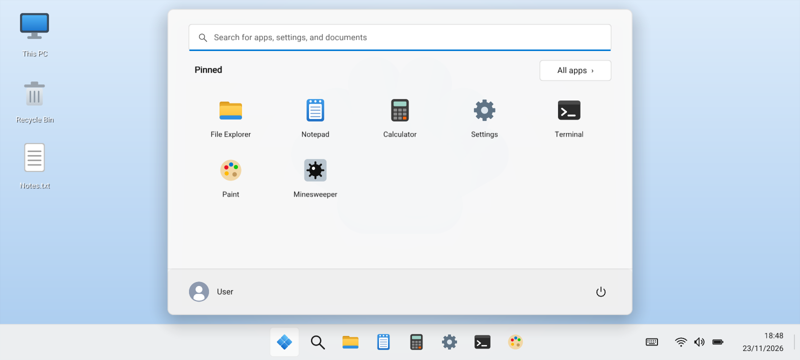

# windows-on-android

**WinDroid** is a Windows 11 style desktop for Android, written from scratch in C++ (NDK + OpenGL ES 2.0). It does not emulate or run real Windows: the shell, the window manager and every app are native code drawn on the GPU.


## Features

- Boot screen, lock screen with clock and status card, sign-in screen with a Welcome transition, restart and shut down screens
- High refresh rate (90/120 Hz) on supported displays and pixel aligned text
- Centered taskbar (or left aligned) with running indicators, clock, tray and show desktop
- Start menu with pinned apps, all apps, recommended files and search
- Real window manager: drag, resize, minimize, maximize, double tap to maximize, snap to the top or sides, open and close animations
- Quick settings (dark mode, night light, brightness, real battery level) and a calendar flyout
- Built-in touch keyboard with symbols and accented characters, plus hardware keyboard support
- Desktop icons and a context menu (new folder, new text document, rename, delete, personalize)
- Light and dark themes, 8 accent colors, 5 wallpapers and display scaling, all saved to disk
- True immersive fullscreen: status and navigation bars hidden (swipe to peek), drawn under the display cutout with safe insets respected

## Apps

| App | What it does |
| --- | --- |
| Browser | Real web browsing with the Chromium engine (Android System WebView): tabs aware of back/forward, address bar with Google search, desktop site mode, typing through the WinDroid keyboard, and an "Open in Chrome" button that launches the page in Google Chrome as a Custom Tab. A WebView is prewarmed at startup and the page stays alive while covered |
| File Explorer | Browses the app's own `C:` drive, creates, renames and deletes files and folders, Recycle Bin, disk usage |
| Notepad | Word wrapped text editor with caret, zoom, Save and Save as |
| Calculator | Standard calculator with the same behavior as the Windows one |
| Settings | System, Personalization, Accounts, Time & language and About (real device specs and GPU) |
| Terminal | Windows Terminal style app with tabs in the title bar, PowerShell and Command Prompt profiles, Campbell colors, syntax highlighting, history and commands like `ls`, `cd`, `Get-Content`, `New-Item`, `Remove-Item`, `tree`, `systeminfo`, `start` |
| Paint | Brush, eraser, bucket fill, 12 colors, undo, saves and opens `.bmp` files |
| Minesweeper | Classic 9x9 game, long press or flag mode to place flags |

| | |
| --- | --- |
|  |  |
|  |  |

## Browser games

The Browser runs HTML5 games out of the box:

- **Fullscreen**: `element.requestFullscreen()` maximizes the window and hides the toolbar. Back, Esc or the ✕ chip exits.
- **Touch controls**: the gamepad button in the toolbar (or the chip in fullscreen) shows an on-screen D-pad and buttons. By default they send Arrow keys, Space (A) and Enter (B) to the page as keyboard events.
- **Keyboard**: with no text field focused, keys typed on the WinDroid keyboard or a physical keyboard reach the game as `keydown`/`keyup`.

### `window.WinDroid` API

Pages can detect WinDroid and integrate with it directly:

```js
if (window.WinDroid) {
  const info = JSON.parse(WinDroid.info());

  WinDroid.fullscreen(true);
  WinDroid.setControls(JSON.stringify({
    dpad: "wasd",
    opacity: 0.6,
    buttons: [
      { id: "jump", label: "A", key: " " },
      { id: "fire", label: "B", key: "j" },
      { id: "pause", label: "II", key: "Escape" }
    ]
  }));
  WinDroid.controls(true);

  WinDroid.save("progress", JSON.stringify({ level: 3 }));
  const saved = JSON.parse(WinDroid.load("progress") || "null");

  WinDroid.vibrate(40);
}

window.addEventListener("windroid", (e) => {
  const d = e.detail;
  if (d.type === "pause") game.pause();
  if (d.type === "resume") game.resume();
  if (d.type === "button") console.log(d.id, d.down);
  if (d.type === "fullscreen") console.log(d.value);
});
```

| Method | Description |
| --- | --- |
| `version()` | API version string |
| `info()` | JSON with platform, device model, Android version, fullscreen and controls state |
| `fullscreen(on)` / `isFullscreen()` | Enter or leave fullscreen without the Fullscreen API |
| `controls(show)` / `hasControls()` | Show or hide the on-screen controls |
| `setControls(json)` | `dpad`: `true`, `false`, `"wasd"` or `{up, down, left, right}` keys; `buttons`: up to 6 `{id, label, key}`; `opacity`: 0.15 to 1 |
| `vibrate(ms)` | Haptic feedback, up to 2000 ms |
| `save(key, value)` / `load(key)` / `remove(key)` / `keys()` / `clear()` | Persistent storage scoped to the page origin |

Events are dispatched on `window` as `windroid` with `detail.type`: `pause` and `resume` when the window goes to the background or comes back, `fullscreen`, and `button` (with `id` and `down`; the D-pad reports `up`, `down`, `left` and `right`). Controls reset to the default layout when a new page loads.

## Bluetooth & devices

Settings > Bluetooth & devices uses the real Android Bluetooth stack: turn Bluetooth on or off, see paired devices with their type, connection state and battery, search for nearby devices, pair, remove and rename. The Bluetooth tile in Quick Settings shows the real state (long press it to open the page). In File Explorer, select a file and use **Send** to share it over Bluetooth.

Game controllers work everywhere: the D-pad and A/B/X/Y/L1/Start navigate WinDroid, and in the Browser they are forwarded to the page with the same key mapping as the on-screen controls (`button` events report `source: 'gamepad'`).

## Windows programs (.exe)

WinDroid opens `.exe` files with **Box64** (x86-64 to ARM64 dynamic recompiler, built in CI as `libbox64.so`) and **Wine**.

- Opening an `.exe` shows its icon, publisher, version, architecture and installer type, with **Run** and **Install**. Installing copies it to `C:\Program Files\<App>` and adds it to **All apps** on the Start menu and, optionally, to the desktop as a shortcut (`.lnk`).
- Settings > Apps downloads the Wine runtime once (or installs it from a local `.tar.gz`), and lists and uninstalls installed apps.
- The runtime package is built by the **Windows Runtime** workflow (`runtime/build-runtime.sh`, Debian + Wine x64) and published to the `runtime-v1` release, which is where WinDroid downloads it from.
- WinDroid's `C:` drive is mapped as `D:` inside Wine.

Current stage: console programs run and their output/input is shown in a console window. Graphical programs start, but their windows need the WinDroid display server, which is the next stage. 64-bit programs are the target; 32-bit ones need a WoW64 runtime. Box64 is built against Android API 31, so running programs needs Android 12 or newer.

## Project layout

```
app/src/main/cpp
  core/       renderer (batched SDF quads), font atlas (stb_truetype), immediate mode UI, file system
  shell/      shell, taskbar, start menu, flyouts, window manager, touch keyboard, icons
  apps/       Explorer, Notepad, Calculator, Settings, Terminal, Paint, Minesweeper, dialogs
  platform/   android_main, EGL, input and JNI glue
app/src/main/java
  WinDroidActivity  NativeActivity subclass: immersive mode, cutout insets, WebView host
```

The browser page is a WebView hosted in a non-focusable popup window that is positioned over the window's client area while it is the active window. When another window, the Start menu or a flyout covers it, the page is captured into a texture and drawn by the GL shell instead, so windows still stack correctly.

Everything else is drawn with one shader that renders rounded rectangles, soft shadows, strokes, text and images. Icons are drawn procedurally in code, so the APK has no image assets.

## Building

Requirements: JDK 17, Android SDK 35, NDK 27 and Gradle 8.14+.

```
gradle assembleRelease
```

The APK is written to `app/build/outputs/apk/release/`. GitHub Actions builds it on every push and uploads it as the `WinDroid-arm64-v8a` artifact.

Target: Android 7.0+ (API 24), `arm64-v8a`.

## Notes

WinDroid is a fan made recreation of the Windows 11 look and is not affiliated with Microsoft. It uses the device system fonts and original procedural artwork.
