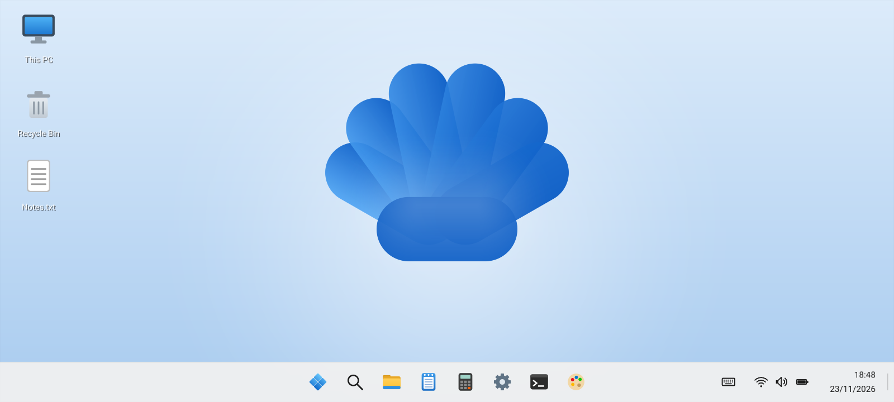
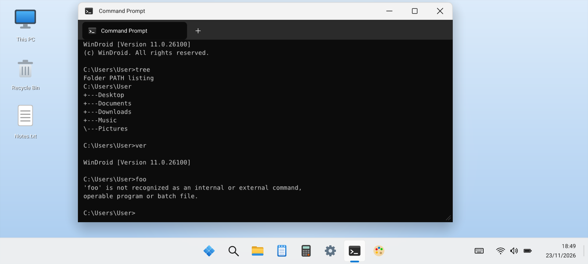

# windows-on-android

**WinDroid** is a Windows 11 style desktop for Android, written from scratch in C++ (NDK + OpenGL ES 2.0). It does not emulate or run real Windows: the shell, the window manager and every app are native code drawn on the GPU.



## Features

- Boot screen, lock screen with clock and status card, sign-in screen with a Welcome transition, restart and shut down screens
- High refresh rate (90/120 Hz) on supported displays and pixel aligned text
- Centered taskbar (or left aligned) with running indicators, clock, tray and show desktop
- Start menu with pinned apps, all apps, recommended files and search
- Real window manager: drag, resize, minimize, maximize, double tap to maximize, snap to the top or sides, open and close animations
- Quick settings (dark mode, night light, brightness, real battery level) and a calendar flyout
- Built-in touch keyboard with symbols and accented characters, plus hardware keyboard support
- Desktop icons and a context menu (new folder, new text document, rename, delete, personalize)
- Light and dark themes, 8 accent colors, 5 wallpapers and display scaling, all saved to disk
- True immersive fullscreen: status and navigation bars hidden (swipe to peek), drawn under the display cutout with safe insets respected

## Apps

| App | What it does |
| --- | --- |
| Browser | Real web browsing with the Chromium engine (Android System WebView): tabs aware of back/forward, address bar with Google search, desktop site mode, typing through the WinDroid keyboard, Chrome extensions from the Chrome Web Store, and an "Open in Chrome" button that launches the page in Google Chrome as a Custom Tab. A WebView is prewarmed at startup and the page stays alive while covered |
| File Explorer | Browses the app's own `C:` drive, creates, renames and deletes files and folders, Recycle Bin, disk usage |
| Notepad | Word wrapped text editor with caret, zoom, Save and Save as |
| Calculator | Standard calculator with the same behavior as the Windows one |
| Settings | System, Personalization, Accounts, Time & language and About (real device specs and GPU) |
| Terminal | Windows Terminal style app with tabs in the title bar, PowerShell and Command Prompt profiles, Campbell colors, syntax highlighting, history and commands like `ls`, `cd`, `Get-Content`, `New-Item`, `Remove-Item`, `tree`, `systeminfo`, `start` |
| Paint | Brush, eraser, bucket fill, 12 colors, undo, saves and opens `.bmp` files |
| Minesweeper | Classic 9x9 game, long press or flag mode to place flags |

| | |
| --- | --- |
|  |  |
|  |  |

## Browser games

The Browser runs HTML5 games out of the box:

- **Fullscreen**: `element.requestFullscreen()` maximizes the window and hides the toolbar. Back, Esc or the ✕ chip exits.
- **Touch controls**: the gamepad button in the toolbar (or the chip in fullscreen) shows an on-screen D-pad and buttons. By default they send Arrow keys, Space (A) and Enter (B) to the page as keyboard events.
- **Keyboard**: with no text field focused, keys typed on the WinDroid keyboard or a physical keyboard reach the game as `keydown`/`keyup`.

### `window.WinDroid` API

Pages can detect WinDroid and integrate with it directly:

```js
if (window.WinDroid) {
  const info = JSON.parse(WinDroid.info());

  WinDroid.fullscreen(true);
  WinDroid.setControls(JSON.stringify({
    dpad: "wasd",
    opacity: 0.6,
    buttons: [
      { id: "jump", label: "A", key: " " },
      { id: "fire", label: "B", key: "j" },
      { id: "pause", label: "II", key: "Escape" }
    ]
  }));
  WinDroid.controls(true);

  WinDroid.save("progress", JSON.stringify({ level: 3 }));
  const saved = JSON.parse(WinDroid.load("progress") || "null");

  WinDroid.vibrate(40);
}

window.addEventListener("windroid", (e) => {
  const d = e.detail;
  if (d.type === "pause") game.pause();
  if (d.type === "resume") game.resume();
  if (d.type === "button") console.log(d.id, d.down);
  if (d.type === "fullscreen") console.log(d.value);
});
```

| Method | Description |
| --- | --- |
| `version()` | API version string |
| `info()` | JSON with platform, device model, Android version, fullscreen and controls state |
| `fullscreen(on)` / `isFullscreen()` | Enter or leave fullscreen without the Fullscreen API |
| `controls(show)` / `hasControls()` | Show or hide the on-screen controls |
| `setControls(json)` | `dpad`: `true`, `false`, `"wasd"` or `{up, down, left, right}` keys; `buttons`: up to 6 `{id, label, key}`; `opacity`: 0.15 to 1 |
| `vibrate(ms)` | Haptic feedback, up to 2000 ms |
| `save(key, value)` / `load(key)` / `remove(key)` / `keys()` / `clear()` | Persistent storage scoped to the page origin |

Events are dispatched on `window` as `windroid` with `detail.type`: `pause` and `resume` when the window goes to the background or comes back, `fullscreen`, and `button` (with `id` and `down`; the D-pad reports `up`, `down`, `left` and `right`). Controls reset to the default layout when a new page loads.

## Chrome extensions

The Browser installs extensions straight from the Chrome Web Store and runs them on top of the WebView:

- Open an extension in the [Chrome Web Store](https://chromewebstore.google.com/category/extensions) and tap the floating **Add to WinDroid** button (or open the extensions button in the toolbar and tap **Add to WinDroid**). WinDroid downloads the CRX, unpacks it and shows what the extension can do before you confirm. Updating works the same way.
- The extensions button (puzzle piece, or type `chrome://extensions` in the address bar) lists installed extensions with their icon, badge, an on/off switch, options and remove. Tapping an extension opens its popup anchored to the toolbar, or sends `action.onClicked` when it has no popup.
- Manifest V2 and V3 are supported. Background service workers, background scripts and background pages run in a hidden WebView that stays alive; popups, options pages and offscreen documents are real extension pages served from `https://<id>.ext.windroid/`.
- Content scripts (`matches`, `exclude_matches`, globs, `run_at`, `all_frames`, `match_about_blank`, JS and CSS) are injected at document start in every frame through `addDocumentStartJavaScript` (with a fallback for older WebView versions).

| API | Support |
| --- | --- |
| `runtime` | `sendMessage`, `onMessage` (sync, `return true` and promises), `connect` / `onConnect` ports, `getURL`, `getManifest`, `id`, `lastError`, `onInstalled`, `onStartup`, `openOptionsPage`, `getPlatformInfo`, `reload` |
| `storage` | `local`, `sync` (kept on the device), `session`, `managed`, `onChanged` |
| `tabs` | `query`, `get`, `getCurrent`, `create`, `update`, `reload`, `remove`, `goBack`, `goForward`, `sendMessage`, `connect`, `executeScript`, `insertCSS`, `onCreated`, `onUpdated`, `onActivated`, `onRemoved` |
| `scripting` | `executeScript` (`func` + `args` or `files`, promise results), `insertCSS`, `removeCSS` |
| `action` / `browserAction` / `pageAction` | badge text and color, title, icon, popup, enable, `onClicked` |
| `alarms` | `create`, `get`, `getAll`, `clear`, `clearAll`, `onAlarm` |
| `i18n` | `getMessage` with placeholders, `getUILanguage`, `_locales` for the device language |
| `cookies` | `get`, `getAll`, `set`, `remove` on the Browser's cookie jar |
| `webNavigation` | `onBeforeNavigate`, `onCommitted`, `onDOMContentLoaded`, `onCompleted`, `onHistoryStateUpdated` |
| `downloads` | `download` (saved to `Downloads`) |
| `notifications` | `create` shows a toast |
| `offscreen` | `createDocument`, `closeDocument`, `hasDocument` |
| `windows`, `permissions`, `management`, `commands`, `extension` | the subset extensions use to find their context |

Extension pages (background, popup, options, offscreen) can `fetch` and `XMLHttpRequest` any site without CORS, like host permissions in Chrome; WinDroid makes those requests natively with the Browser's cookies.

Limits: WebView has no isolated worlds, so content scripts share the page's JavaScript world (their `chrome` object is passed privately, not exposed on `window`). `declarativeNetRequest`, `webRequest` blocking, `contextMenus`, side panels, DevTools pages, native messaging and Google sign in (`identity`) are accepted but do nothing, so ad blockers that depend on them won't block requests. `scripting` and `tabs.executeScript` only reach the top frame.

## ZIP and RAR archives

Open a `.zip` or `.rar` file (or select it in File Explorer and use **Extract all**, or long press it on the desktop) to get the Extract dialog: choose the destination folder, enter a password if the archive is encrypted, and follow the progress. The extracted folder opens when it finishes.

- ZIP is handled natively with zlib (Deflate and Stored, ZIP64, traditional ZipCrypto passwords).
- RAR uses the official **UnRAR library by RARLAB**, the same API as WinRAR's `unrar.dll` (`RAROpenArchiveEx`, `RARReadHeaderEx`, `RARProcessFileW`). RAR 3 and RAR 5, solid and multi-volume archives, encrypted files and encrypted headers are supported. Archives with unsafe paths or links are refused. The CI fetches the UnRAR source into `app/src/main/cpp/third_party/unrar`; builds without it still extract ZIP.

UnRAR license: UnRAR source code may be used in any software to handle RAR archives without limitations free of charge, but cannot be used to develop RAR (WinRAR) compatible archiver and to re-create RAR compression algorithm, which is proprietary. Distribution of modified UnRAR source code in separate form or as a part of other software is permitted, provided that full text of this paragraph, starting from "UnRAR source code" words, is included in license, or in documentation if license is not available, and in source code comments of resulting package.

## Downloads

Files downloaded in the Browser go to `C:\Users\User\Downloads`. A downloads button appears in the toolbar with a progress ring, and its flyout lists recent downloads with size, speed and time left, plus cancel, retry, open file and show in folder. Links, `data:` URLs and `blob:` URLs created by web apps (including the `<a download>` name) are supported.

## Sounds

WinDroid plays its own synthesized system sounds in the spirit of Windows 11: startup, sign in, shut down, notification, message, error, device connected and disconnected, and volume change. They are generated as WAV files on first launch (`core/Sound.cpp`) and can be turned off or tried in Settings > System > Sound. The volume slider in Quick Settings sets their volume.

## Bluetooth & devices

Settings > Bluetooth & devices uses the real Android Bluetooth stack: turn Bluetooth on or off, see paired devices with their type, connection state and battery, search for nearby devices, pair, remove and rename. The Bluetooth tile in Quick Settings shows the real state (long press it to open the page). In File Explorer, select a file and use **Send** to share it over Bluetooth.

Game controllers work everywhere: the D-pad and A/B/X/Y/L1/Start navigate WinDroid, and in the Browser they are forwarded to the page with the same key mapping as the on-screen controls (`button` events report `source: 'gamepad'`).

## Windows programs (.exe)

WinDroid runs `.exe` files with **Box64** and **Wine** inside a Debian arm64 root filesystem started through **proot**:

```
WinDroid ── proot ── Xvfb :1 (native arm64, framebuffer in /tmp/Xvfb_screen0)
                 └── box64 → wine64 explorer /desktop=WinDroid,WxH start /unix <app.exe>
WinDroid "Windows" window ── reads the framebuffer, sends touch and keys over the X socket (XTEST)
```

- Opening an `.exe` shows its icon, publisher, version, architecture and installer type, with **Run** and **Install**. Installing copies it to `C:\Program Files\<App>` and adds it to **All apps** on the Start menu and, optionally, a desktop shortcut.
- Graphical programs open in the **Windows** window: tap to click, drag to drag, long press (or the Right click button) for a right click, and the keyboard button for typing. Console programs run in a console window with input and output.
- Settings > Apps downloads the runtime once (or installs it from a local `.tar.gz`) and lists and uninstalls installed apps.
- The runtime is built by the **Windows Runtime** workflow (`runtime/build-runtime.sh`) and published to the `runtime-v2` release, which is where WinDroid downloads it from. proot comes from the Termux packages and is bundled in the APK by the Android Build workflow.
- WinDroid's `C:` drive is mounted at `/mnt/c` and appears as `D:` inside Wine.
- `targetSdk` is 28 so the runtime can execute binaries from the app's private storage, like Termux and Winlator.

## Project layout

```
app/src/main/cpp
  core/       renderer (batched SDF quads), font atlas (stb_truetype), immediate mode UI, file system
  shell/      shell, taskbar, start menu, flyouts, window manager, touch keyboard, icons
  apps/       Explorer, Notepad, Calculator, Settings, Terminal, Paint, Minesweeper, dialogs
  platform/   android_main, EGL, input and JNI glue
app/src/main/java
  WinDroidActivity  NativeActivity subclass: immersive mode, cutout insets, WebView host
  Extensions        Chrome extension host: Web Store install, content scripts, messaging, background and popup pages
app/src/main/assets/wdx
  runtime.js        the chrome.* API shared by content scripts and extension pages
  content.js        per-extension document start bootstrap that matches and runs content scripts
  page.js           bootstrap for extension pages: transport, CORS-free fetch/XHR, popup sizing, service worker shim
```

The browser page is a WebView hosted in a non-focusable popup window that is positioned over the window's client area while it is the active window. When another window, the Start menu or a flyout covers it, the page is captured into a texture and drawn by the GL shell instead, so windows still stack correctly.

Everything else is drawn with one shader that renders rounded rectangles, soft shadows, strokes, text and images. Icons are drawn procedurally in code, so the APK has no image assets.

## Building

Requirements: JDK 17, Android SDK 35, NDK 27 and Gradle 8.14+.

```
gradle assembleRelease
```

The APK is written to `app/build/outputs/apk/release/`. GitHub Actions builds it on every push and uploads it as the `WinDroid-arm64-v8a` artifact.

Target: Android 7.0+ (API 24), `arm64-v8a`.

## Notes

WinDroid is a fan made recreation of the Windows 11 look and is not affiliated with Microsoft. It uses the device system fonts and original procedural artwork.
